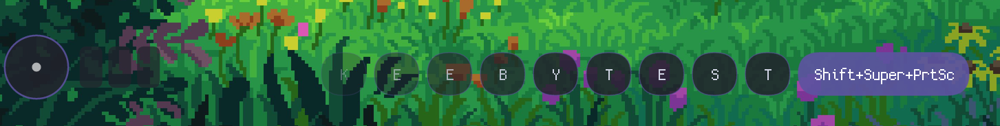
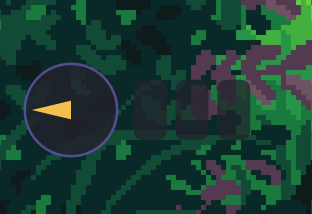

# keeby

Your keyboard and mouse, on screen and in control, on Wayland. Pure Rust, one small binary, no GTK, no Qt, no Electron.

- **Overlay**: shows what you press and what the mouse does, for screencasts, streams and pair-debugging.
- **Pointer**: move, click, double click and drag the mouse from the keyboard (`keeby point`), with labels on every clickable thing on screen.

Both run in one daemon, share one theme, and the keys you type into the pointer show up in the overlay too.





## Features

### Overlay

- **Keystroke stream**: every press appears as a pill, the oldest scrolls left and fades after a few seconds
- **Chord pills**: `Ctrl+Shift+A` is one pill, not three; modifier-only presses don't clutter the stream
- **Mouse widget**: cursor disc with a motion arrow, button cells that light on click, scroll chevrons
- **Any input**: keyboards, mice, touchpads (motion, two-finger scroll, taps, clickpad clicks), tablets and virtual devices; hot-plug without restarting
- **Device whitelist**: pick keyboards and mice by name when a headset's media keys get in the way
- **Privacy key**: one tap (default `Pause`) stops capturing and clears the screen, another tap resumes

### Pointer (`keeby point`)

- **Five modes you can chain**: `floating` (labels on detected targets or on areas from stdin), `tile` (labelled grid), `bisect` (halve with home row keys), `split` (halve with the arrows), `click`
- **Target detection**: finds buttons, links and icons on screen (OpenCV), about 12 ms for a 1080p screen
- **Left, middle, right, double click and drag**, with any button; `Shift` + a click key double clicks
- **Menus stay open**: the keyboard is grabbed from `/dev/input`, so the focused app keeps its focus and open dropdowns and context menus don't close
- **Fast**: the daemon keeps the Wayland connection, fonts and buffers warm, so the overlay is up in a frame or two
- **Safe**: if nothing is pressed for 30 s, or the service stops responding, the keyboard is handed back

### Shared

- **One theme** for everything: paste your `pywal` / `hellwal` / `wallust` colors and both the overlay and the pointer follow; any single color can still be overridden
- **Built-in legible font**: [Atkinson Hyperlegible Mono](https://www.brailleinstitute.org/freefont/), made by the Braille Institute so look-alike characters (l/1/I, O/0) stay distinct; any `.ttf`/`.otf` or fontconfig family works too
- **Wayland-native**: `wlr-layer-shell`, click-through, never steals focus

## Install

### Arch (build from source)

```fish
sudo pacman -S --needed rust opencv pixman
git clone https://github.com/GabriWar/keeby.git
cd keeby
cargo build --release
install -Dm755 target/release/keeby ~/.local/bin/keeby
```

Target detection needs OpenCV (5 or 4) and pixman. Without them, build with `cargo build --release --no-default-features`: everything works except `mode_floating.source = detect`.

### Permissions

keeby reads `/dev/input/event*` directly (Wayland doesn't let clients see each other's input, so there's no other way). Add yourself to the `input` group once, then log out and back in:

```fish
sudo gpasswd -a $USER input
```

Without it, `keeby point` still works but takes the keyboard focus the normal way, which closes open menus.

## Usage

```fish
keeby                 # overlay + pointer service
keeby point ...       # one pointer selection (talks to the daemon, or runs on its own)
keeby config          # edit the settings in the browser
keeby --list          # keyboards, mice and monitors keeby can see
keeby point --help    # pointer options
```

Start it with your session (Hyprland):

```ini
exec-once = keeby
```

### Pointer keybinds

`keeby point` takes the same options as [wl-kbptr](https://github.com/moverest/wl-kbptr): `-o section.key=value`, `-d` (drag), `-D` (double click), `-r wxh+x+y`, `-O output`, `-p` (print only), `-c file`. Some Hyprland binds:

```ini
bind = ALT, KP_4, exec, keeby point -o modes=floating,click -o mode_floating.source=detect
bind = ALT SHIFT, KP_4, exec, keeby point -d -o modes=floating,click -o mode_floating.source=detect
bind = ALT, KP_3, exec, keeby point -o modes=split
```

While the labels are up: type a label to pick it, arrows split, `Enter` moves without clicking, `g` / `h` / `b` click left / right / middle (`Shift` for a double click), `Backspace` steps back, `Esc` cancels.

Every pick prints `wxh+x+y +ox+oy click` (the area, the output's position and `l`, `m`, `r`, `d` or `n`), so scripts can use it with `-p`.

## Configuration

The first launch writes `~/.config/keeby/config.conf`. Every key is optional.

`keeby config` opens a settings page in your browser with every option, color pickers with transparency, and Save & apply (which restarts keeby). It edits the same file and keeps your comments.

```ini
# --- theme: one palette for the overlay and the pointer ---
# font = /path/to/font.ttf or a fontconfig family (unset: built-in Atkinson Hyperlegible Mono)
bg_color        = #21222cd9
accent_color    = #5c52a0eb
text_color      = #ffffffff
text_dim_color  = #d2d6e6ff
highlight_color = #ffc750f2   # mouse arrow, typed label prefix, pointer crosshair
shade_color     = #22222266   # dims the screen behind the pointer

# --- overlay ---
size = 26
margin_bottom = 80            # from the top/bottom edge
keys_anchor = bottom          # same choices as mouse_anchor
keys_margin_x = 0             # from the left/right edge
life = 3.5
fade = 1.0
mouse_enabled = true
mouse_anchor  = bottom-left   # top-left, top, top-right, left, center, right, bottom-left, bottom, bottom-right
monitor = auto                # or eDP-1, HDMI-A-1, ...
keyboards =                   # whitelist by name substring, empty = all
mice      =                   # also applies to touchpads and tablets
auto_hide_mouse = false       # hide the mouse widget after auto_hide_mouse_secs idle
privacy_key = Pause

# --- pointer: `section.key = value`, same names as wl-kbptr ---
general.modes = floating,click
mode_floating.source = detect
mode_split.bg_color = #00000080      # any color can be set on its own, alpha included
mode_tile.label_font_family = Atkinson Hyperlegible
```

Colors take `#rgb`, `#rgba`, `#rrggbb` or `#rrggbbaa`. `keeby point --help-config` lists every pointer option.

## How it works

- Two event loops, one Wayland connection each: the overlay (keys and mouse widget) and the pointer service, which listens on `$XDG_RUNTIME_DIR/keeby-point.sock`
- Input devices and hotplug (`inotify` on `/dev/input`) are sources in the overlay's event loop: no reader threads. Devices are classified by capability, so a keyboard with mouse keys is both, and touchpads get motion, two-finger scrolling, taps and clickpad clicks from their raw contacts
- Click-through layer surfaces with an empty input region, drawn with `tiny-skia` and `fontdue` straight into two reused `wl_shm` buffers per surface, frame-callback paced; a timer wakes the key overlay exactly when a pill starts fading
- The pointer moves the cursor with `wlr-virtual-pointer`, captures the screen with `wlr-screencopy` (started before the overlay is even mapped) and runs detection on the captured buffer in place
- Keys for the pointer come from an exclusive evdev grab taken once the hotkey's modifiers are released, so the compositor never sees them stuck

## Compositor support

Tested on Hyprland. Anything with `wlr-layer-shell`, `wlr-virtual-pointer` and (for detection) `wlr-screencopy` should work: Sway, river, niri, labwc, Wayfire. GNOME and KDE Plasma don't implement layer-shell.

## Credits

- The pointer is a Rust port of [wl-kbptr](https://github.com/moverest/wl-kbptr) by moverest, and its target detection (`csrc/target_detection.cpp`) is wl-kbptr's code, sped up. Thanks to moverest and wl-kbptr's contributors.
- [Atkinson Hyperlegible Mono](https://github.com/googlefonts/atkinson-hyperlegible-next-mono) by the Braille Institute and the Atkinson Hyperlegible Mono Project Authors, bundled under the SIL Open Font License 1.1 (`assets/fonts/OFL.txt`).

## License

GPL-3.0-only (see `LICENSE`), as required by the wl-kbptr code it includes. The bundled font is under the SIL Open Font License 1.1.
